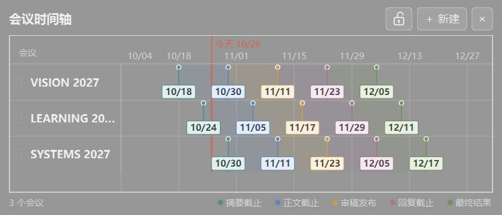

# PaperCalendar

一个轻量的 Windows Qt 桌面会议时间轴，把多场会议的投稿与审稿日期并排展示。



*实际 Qt 界面；会议名称和日期均为虚构演示数据。*

## 功能

- 每场会议包含摘要截止、正文截止、审稿发布、回复截止、最终结果五个日期，支持留空。
- 浅色区间表示相邻阶段，节点对应具体日期；摘要截止前不绘制人为区间。
- 点击底部图例更换阶段颜色，节点、标签和区间同步更新。
- 日期标签自动错开，悬停查看日期和剩余天数，点击展开详情。
- 半透明灰色背景，默认桌面伴随与锁定功能，顺序、颜色和窗口设置自动保存。

## 下载与运行

从 [最新 Release](https://github.com/Sur-Ring/PaperCalendar/releases/latest) 下载 `PaperCalendar-v1.0.0-windows-x64.zip`，**解压整个文件夹**，双击 `PaperCalendar.exe`。包内附带 Qt 和 MinGW 运行依赖，无需安装 Qt；请保留 DLL 和插件目录。

发布环境为 Windows 11 x64、Qt 6.8.3。其他 Windows 版本尚未验证。首次启动为空列表，截图仅为演示数据。

## 操作

| 操作 | 效果 |
| --- | --- |
| 左侧名称区滚轮 | 上下滚动列表 |
| 右侧时间轴滚轮 | 平移时间范围 |
| 时间轴 Ctrl＋滚轮 | 缩放时间范围 |
| 单击名称 | 编辑或删除记录 |
| 拖动左侧六点柄 | 调整行顺序 |
| 选中行后 Alt＋↑ / ↓ | 调整行顺序 |
| 点击越界的“← 今天”或“今天 →” | 回到今天附近 |
| 点击锁图标 | 锁定／解锁窗口位置及大小 |

日期表头和今天标注固定在顶部；每次启动默认显示今天。解锁后可拖动标题区域移动窗口、拖动边缘调整大小，× 退出应用。

## 数据与自启动

默认数据目录为 `%APPDATA%/PaperCalendar/PaperCalendar/`，保存 `conferences.json` 和 `settings.ini`。更新程序前备份该目录；替换程序文件不会清空这里的数据。也可指定便携数据目录：

```powershell
.\PaperCalendar.exe --data-dir .\my-data
```

登录 Windows 时自动启动：按 Win＋R，输入 `shell:startup`，将 `PaperCalendar.exe` 的**快捷方式**放入打开的文件夹。快捷方式应指向固定存放的完整程序目录；移除该快捷方式即可取消自启动。

## 从源码构建

需要 CMake 3.16+、C++17、Ninja 和 Qt Widgets。编译器必须与 Qt ABI 匹配，并将 Qt 与编译器的 bin 加入 PATH。测试还需要 Qt Test。

```powershell
cmake -S . -B build -G Ninja -DCMAKE_PREFIX_PATH="你的 Qt 安装目录"
cmake --build build --target PaperCalendar CalendarTests
ctest --test-dir build --output-on-failure
```

本版本已通过 Windows 原生平台及 offscreen 自动测试。测试使用临时数据，不访问真实记录。可通过 `-DBUILD_TESTING=OFF` 关闭测试目标。

## 许可

项目沿用仓库中的 [GNU AGPL v3](LICENSE)。发行包使用动态链接的 Qt，第三方许可与来源见 `THIRD_PARTY_NOTICES.md` 和包内 `licenses/`。源码可从本仓库对应 Release 标签获取。

## 设计与实验

[设计文档](docs/design.zh-CN.md)与 [HTML 原型](docs/ui-prototype.html)用于设计参考，实际界面以本 README 截图为准。源码保留桌面挂载实验，但默认使用桌面伴随后端；WorkerW 在本机显示验证失败，不建议启用。多显示器、Explorer 重启、全屏与 Win＋D 的全部组合仍需人工验证。日期按本地日历日处理，不执行 AoE 时区转换。
